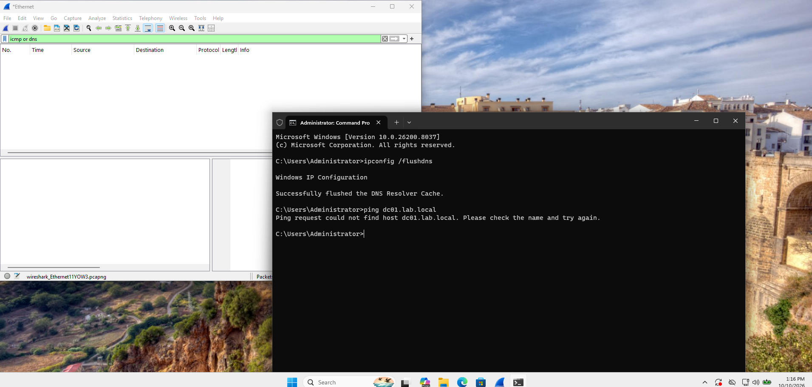
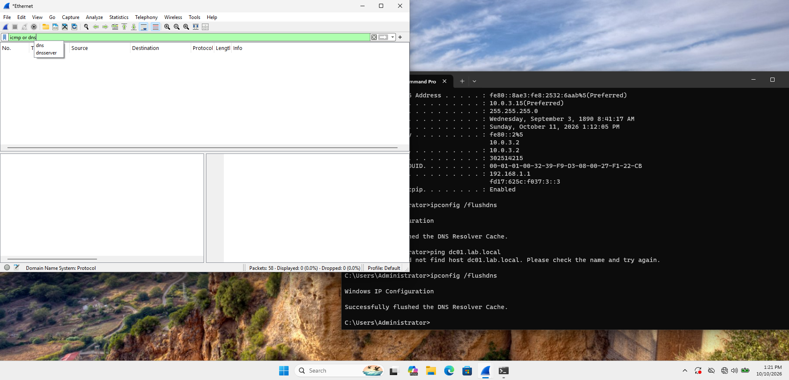
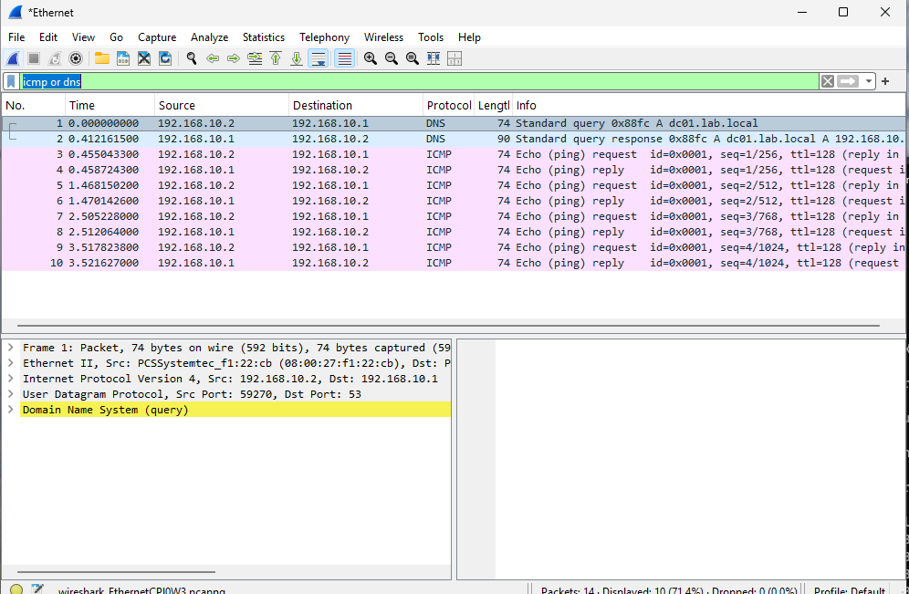
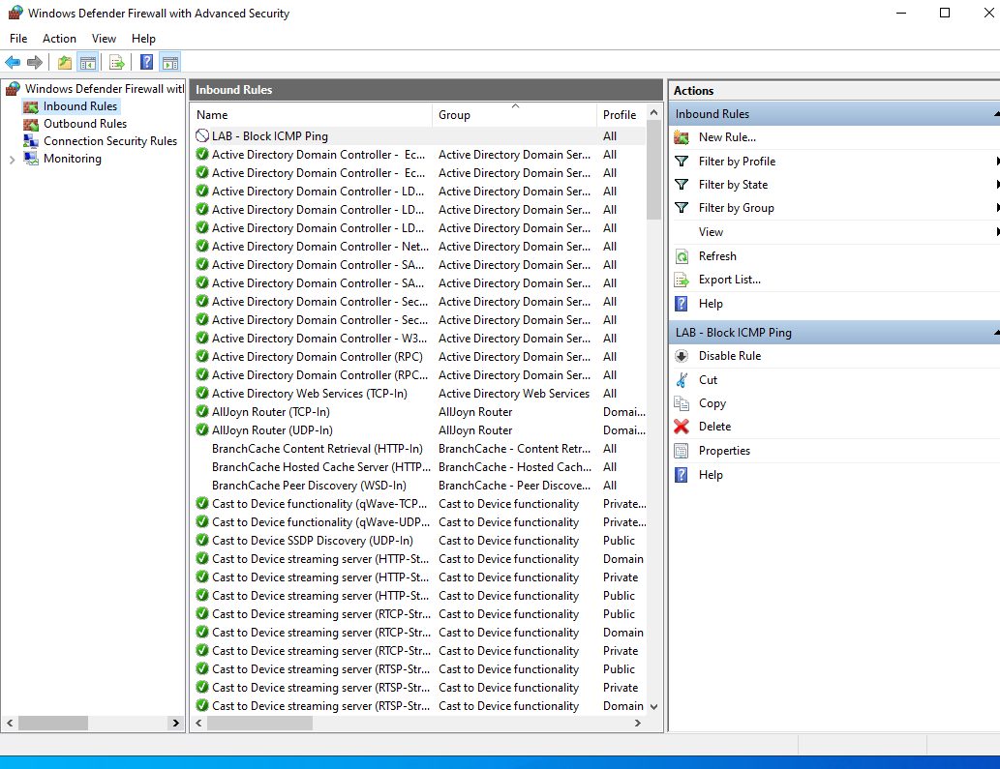
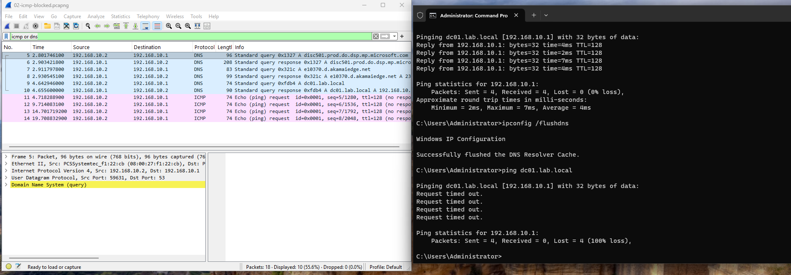
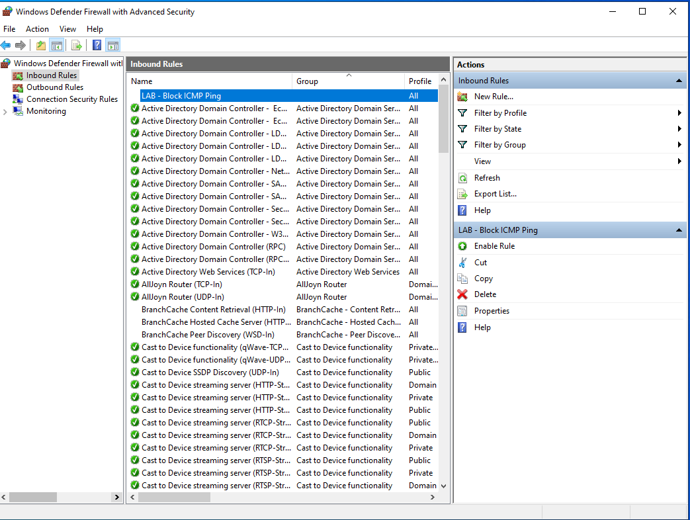
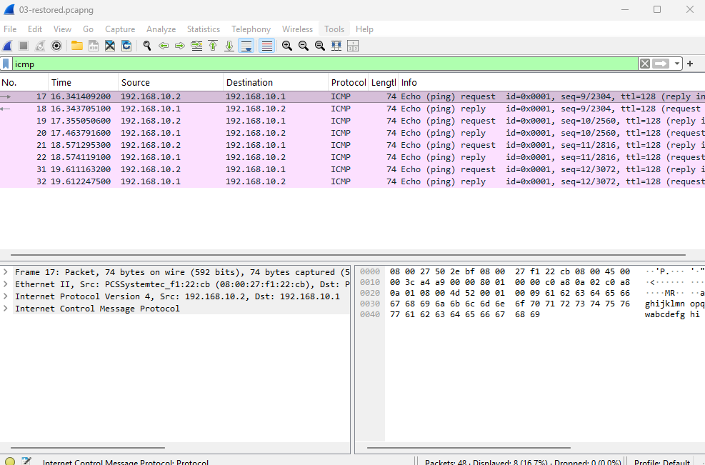

# Wireshark + Firewall: "Ping fails" doesn't mean "server is down"

Built on the [Active Directory lab](../../active-directory-lab) (DC01 at 192.168.10.1,
Client01 at 192.168.10.2, domain `lab.local`). The idea: capture normal traffic between
the client and the domain controller, then block ping with a Windows Firewall rule on the
DC and use Wireshark to tell the difference between a dead server and a filtered one.

From the command line, both look exactly the same. In a packet capture, they don't.

## Before the lab even started: two problems at once

Installed Wireshark on Client01 (needed a temporary second NAT adapter for internet
access to download it), started capturing on the `Ethernet` adapter, ran
`ping dc01.lab.local` — and got `could not find host`, with **zero** packets in the
capture.

An empty capture was actually the useful clue: if the client had asked DC01 for DNS,
the query would have shown up on this interface whether or not it got an answer. So the
query was going somewhere else. `ipconfig /all` showed why:

The second (NAT) adapter had picked up `192.168.1.1` — my home router — as its DNS
server, and Windows was using it to resolve `dc01.lab.local`. The router has never heard
of my lab domain. Disabled that adapter (Wireshark was already installed, so it wasn't
needed anymore).

Still failed. Turned out DC01 simply wasn't running — I'd started only the client.
With no DC on the network, ARP gets no answer for 192.168.10.1, so the DNS request never
even leaves. Two causes, same symptom. Started DC01 and everything resolved.

## Baseline: what normal looks like

Filter: `icmp or dns`. Ran `ipconfig /flushdns` first so the client had to do a fresh DNS
lookup instead of using its cache.

- Packets 1–2: DNS query for `dc01.lab.local` → response with `192.168.10.1`
  (UDP, destination port 53)
- Packets 3–10: four ICMP `Echo (ping) request` → `Echo (ping) reply` pairs, seq 1–4,
  each answered within a few milliseconds

## Breaking it: block ICMP on the DC

On DC01, Windows Defender Firewall with Advanced Security → Inbound Rules → New Rule:
Custom → All programs → Protocol **ICMPv4** → Any IP → **Block** → all profiles. Named it
`LAB - Block ICMP Ping`.

Windows already ships with a rule that *allows* ping, but block rules take priority over
allow rules, so this overrides it. Only ICMP is affected — the Active Directory rules
right below it (LDAP, Kerberos, DNS, etc.) stay open, so the domain keeps working.

## The interesting part

Same test from Client01:

**Command prompt:** `Request timed out` ×4, 100% loss. Taken at face value, that reads
as "the server is down."

**Wireshark says otherwise:**
- Packets 9–10: DNS query for `dc01.lab.local` and a **response from 192.168.10.1** — the
  server is up and answering
- Packets 11–14: only `Echo (ping) request`, each tagged **(no response found!)**, about
  five seconds apart. The requests reach DC01; the firewall silently drops them

So the server is fine and reachable — it's just filtering ICMP. Without the capture, this
is indistinguishable from an outage. (It also means my
[Python ping script](../../python-network-check) would report DC01 as DOWN here, which is
a real limitation of ping-only monitoring.)

Packets 5–8 are Windows doing its own background lookups (Microsoft and Akamai domains) —
normal noise in any real capture, and a good reason to always filter.

## Fixing it

Disabled the rule rather than deleting it, so it can be switched back on to repeat the
test:

Ping works again. Filtered on `icmp` only to cut out the background DNS noise:

Four clean request/reply pairs. The bottom-right pane shows the packet payload —
`abcdefghijklmnopqrstuvwabcdefghi`, the standard filler Windows puts in every ping.

(One more thing from this capture worth noting: queries for `wpad.lab.local` getting
"No such name." That's Windows looking for a proxy auto-config file. Harmless here, but
WPAD lookups are something security teams watch because they can be abused for
traffic interception.)

## Takeaways

- An **empty** capture is evidence too — it tells you traffic isn't taking the path you
  assumed.
- Multiple network adapters can quietly change which DNS server gets used.
- "Request timed out" only tells you no reply came back. Wireshark tells you *why*: here,
  requests arrived and were dropped, while DNS from the same host kept working.
- Disable rather than delete when testing, so the change is easy to reverse.

Tools: Wireshark (with Npcap), Windows Defender Firewall with Advanced Security, `ping`,
`ipconfig`. Captures saved as `01-baseline.pcapng`, `02-icmp-blocked.pcapng`,
`03-restored.pcapng`.
